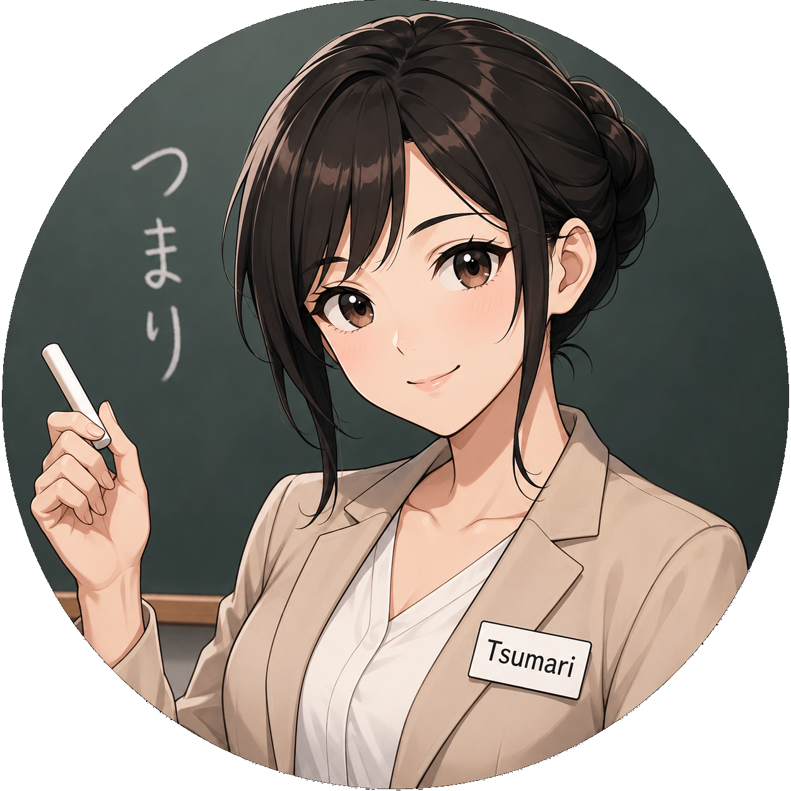

# Tsumari

A .NET 10 Discord bot that translates and mirrors messages across linked master/localized channels. It preserves message links and replies, synchronizes text edits/deletions, mirrors standard reactions and attachments, replays missed messages, and stores channel/message mappings in SQLite.

## Start here

- [Configuration, local secrets and build injection](docs/configuration.md)
- [Deployment, bot terminal and Windows shortcut](docs/DEPLOYMENT.md)
- [Translation backends and model profiles](docs/models.md)
- [Routing, edits, replies, deletion, reactions and synchronization](docs/routing.md)
- [Message examples](docs/examples.md)
- [Attachments and upload limits](docs/media.md)
- [Retry button and command](docs/translation-retries.md)
- [SQLite schema and data protection](docs/database.md)
- [Backend retries and circuit breakers](docs/resiliency.md)
- [Offline model/prompt evaluation](tools/Tsumari.Evaluation/README.md)
- [Repair existing failed translations](tools/Tsumari.Repair/README.md)

## Requirements and setup

Install the .NET 10 SDK and PowerShell 7 (`pwsh`). Create a Discord bot, enable its Message Content intent, and grant access to the channels it will mirror, including the message/history, attachment, reaction and interaction permissions required by the chosen features. Use a bot token, never a user-account token.

For the local baseline, install/run Ollama and obtain `translategemma:12b`. DeepL and OpenAI-compatible endpoints are also supported. Language listings do not establish translation quality; see [model guidance](docs/models.md).

Create ignored `.local/appsettings.secrets.json` with your runtime settings, for example:

```json
{
  "Discord": { "Token": "YOUR_DISCORD_BOT_TOKEN" },
  "Translation": {
    "Provider": "Ollama",
    "Ollama": {
      "ApiUrl": "http://localhost:11434/api/generate",
      "Model": "translategemma:12b",
      "KeepAlive": "15m"
    }
  },
  "Database": { "FilePath": "tsumari.db" },
  "Logging": { "LogLevel": { "Default": "Information", "Microsoft.Hosting.Lifetime": "Information" } }
}
```

Replace the token placeholder. Existing installations can retain their complete local override. Source `appsettings.json` and `appsettings.Development.json` are also ignored; **they are not checked-in defaults**. Build/publish merges source settings, the tracked model catalogue, then the local override. Generated settings contain credentials and must remain private.

## Build, verify and deploy

Keep build output separate from a running release:

```powershell
dotnet build Tsumari.slnx --artifacts-path .artifacts/build
dotnet test tests/Tsumari.Bot.Tests/Tsumari.Bot.Tests.csproj --artifacts-path .artifacts/tests --nologo
dotnet test tests/Tsumari.Repair.Tests/Tsumari.Repair.Tests.csproj --artifacts-path .artifacts/tests --nologo
pwsh -NoProfile -File tests/deployment/Deploy.Tests.ps1
```

Deploy locally:

```powershell
pwsh -NoProfile -File ./Deploy.ps1 -ValidateOnly
pwsh -NoProfile -File ./Deploy.ps1
```

Deployment publishes/validates before stopping the target release's instances, preserves SQLite files/sidecars, copies application files, then starts the new version. Windows opens a separate **Tsumari Bot** terminal with terminal-only output; Unix inherits the invoking terminal. Default release folder: `src/Tsumari.Bot/bin/Release/net10.0`. Relative database paths resolve from that folder.

`Install-DeploymentShortcut.ps1` creates Windows Desktop/Start Menu shortcuts with the Tsumari icon. Pin **Tsumari Deploy** through Start's context menu; clicking it performs a real deployment. See the [deployment guide](docs/DEPLOYMENT.md) for recovery, platform limits and shortcut details.

For a development run, use the build output directory as working directory when relying on a relative database filename, or configure an absolute `Database:FilePath`. See [configuration](docs/configuration.md).

## Commands

Guild `/tsumari` commands require Administrator permissions. Configuration/status/sync/retry commands require a guild. Language probes can also run in DMs; command availability and runtime authorization are separate checks.

| Command | Purpose |
| --- | --- |
| `/tsumari add-master [channel]` | Register a master channel |
| `/tsumari register-local [local-channel] [master-channel] [language-code]` | Register/update a localized child |
| `/tsumari unregister [channel]` | Remove channel configuration |
| `/tsumari sync [master-channel] [hours]` | Replay untracked messages; manual window 1–168 hours |
| `/tsumari status` | Private database/provider status |
| `/tsumari detect-language [text]` | Private provider-backed analysis |
| `/tsumari translate [target-language] [text]` | Private analysis/translation diagnostic |
| `/tsumari retry [message]` | Retry a localized copy by jump link |

Localized copies also have a gray `↻` button. Its authorization differs from the administrator-only slash-command group; see [retries](docs/translation-retries.md).

## Behavior and limits

- Text edits update existing links; attachment-only edits do not re-upload files.
- Locale targets stay distinct (`PT`, `PT-BR`, `PT-PT`). Generic detection can inherit its source channel's locale.
- Exactly two detected languages collapse to one when the primary share is at least 85% and the secondary at most 15%, with both shares known. This is label policy, not a quality guarantee.
- Analysis and translation have separate circuit breakers. Gateway work is queued in order per linked channel cluster.
- Analysis failure can use an English routing/display fallback; it is not passed as a trusted source hint to translation.
- Retry counters `1️⃣`–`🔟` are reserved from mirroring. Standard non-counter reactions are mirrored; burst reactions are ignored.
- DeepL alone uses the monthly 500,000-character quota guard. Successful analysis and translation can each increment usage.
- Historical/startup synchronization skips tracked messages and processes oldest first. Startup sync follows Ready events and retains scan limits.

## Repository layout

```text
Deploy.ps1 / Run-TsumariConsole.ps1 / Install-DeploymentShortcut.ps1
build/                         Build-time configuration merge
src/Tsumari.Bot/                Bot and translation providers
tests/                        Bot, repair and deployment checks
tools/Tsumari.Evaluation/       Model/prompt evaluation and report generators
tools/Tsumari.Repair/           REST-only repair utility
docs/                          Feature and operator guides
docs/model-evaluation/          Dated results and reusable evaluation data
```

Ignored `.local/`, `.artifacts/`, `.repair-runs/`, source settings, SQLite files and build folders are local state. Never mirror/delete the release directory or replace the database during an application update.

## Maintaining documentation

README covers setup/navigation; feature guides describe implementation; dated evaluation reports record measurements. Completed plans and audit narratives do not define runtime behavior. Model responses are observations, not gold translations or current deployment-state claims.

Run `python tools/check_docs.py` after edits (Python 3). It inventories all Markdown and checks local links/headings in maintained documents. Ignored historical/private reports are read for inventory and preserved. The checker does not verify external websites or replace source-code review.

The 14 November 2026 build verification still reported the existing NU1903 advisory for transitive `SQLitePCLRaw.lib.e_sqlite3` 2.1.11. Dependency remediation was outside the documentation cleanup; inspect current build/package-audit output rather than interpreting a successful build as a clean security audit.
